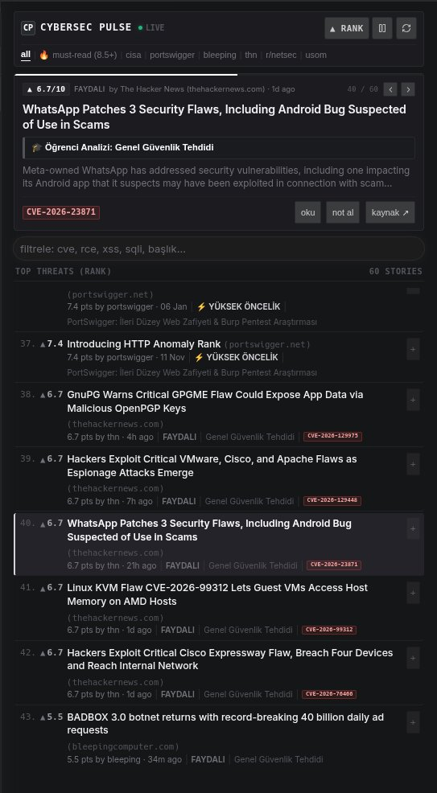
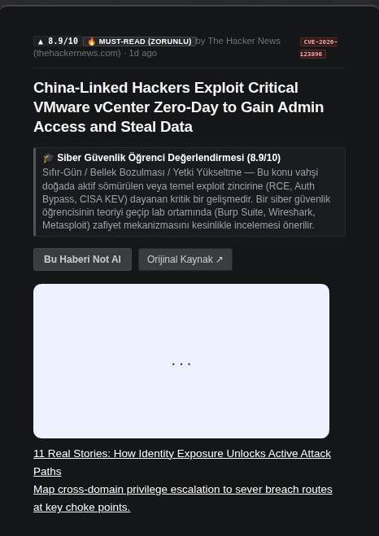

# CyberSec Pulse

Minimalist cybersecurity threat radar, live wire feed, and 1-click vault note clipper for Obsidian.

<p align="center">
  <a href="https://obsidian.md"></a>
  <a href="https://github.com/Nasuhii/cybersec-pulse/releases/latest"></a>
  <a href="LICENSE"></a>
</p>

<p align="center">
  
  &nbsp;&nbsp;
  
</p>

---

## Features

- **Threat Wire & Rank View**: Sequential headline rotator with live progress bar, smart hover-to-pause, and synchronized chronological feed.
- **In-App Reader**: Distraction-free modal reader with automatic CVE detection and priority scoring.
- **1-Click Note Clipper**: Saves articles as structured Markdown notes with YAML frontmatter, CVE tags, and Anki flashcards.
- **6 Intelligence Feeds**: CISA KEV, BleepingComputer, The Hacker News, PortSwigger Research, `/r/netsec`, and USOM.
- **Search & Filter**: Instant filtering by source or CVE ID (e.g., `CVE-2026-`).

---

## Installation

### Option 1: BRAT (Recommended)
1. Install and enable **Obsidian42 - BRAT** from Community Plugins.
2. Open **Settings -> BRAT -> Add Beta plugin**.
3. Enter `https://github.com/Nasuhii/cybersec-pulse` and click **Add Plugin**.
4. Enable **CyberSec Pulse** under **Community plugins**.

### Option 2: Manual / Git Clone
```bash
cd /path/to/vault/.obsidian/plugins
git clone https://github.com/Nasuhii/cybersec-pulse.git cybersec-pulse
```
Or download `main.js`, `manifest.json`, and `styles.css` from [Releases](https://github.com/Nasuhii/cybersec-pulse/releases/latest) into `.obsidian/plugins/cybersec-pulse/`, then reload and enable the plugin in Obsidian.

---

## Settings

Configure under **Settings -> CyberSec Pulse**:

| Setting | Default | Description |
| :--- | :--- | :--- |
| **Save Folder** | `Areas/CyberSecurity/Haberler` | Destination directory for clipped notes |
| **Rotation Interval** | `300` sec | Interval between headline transitions |
| **Max Items per Feed** | `15` | Number of items fetched per source (5–30) |
| **Auto Full Content** | `Enabled` | Extracts full article body into the reader and saved notes |
| **Feed Toggles** | `All ON` | Enable or disable individual intelligence sources |

---

## License

[MIT](LICENSE) — [Nasuhii](https://github.com/Nasuhii)
